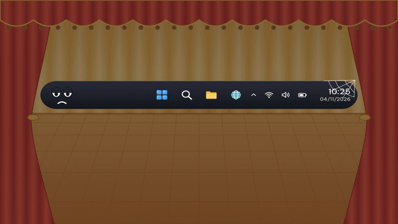
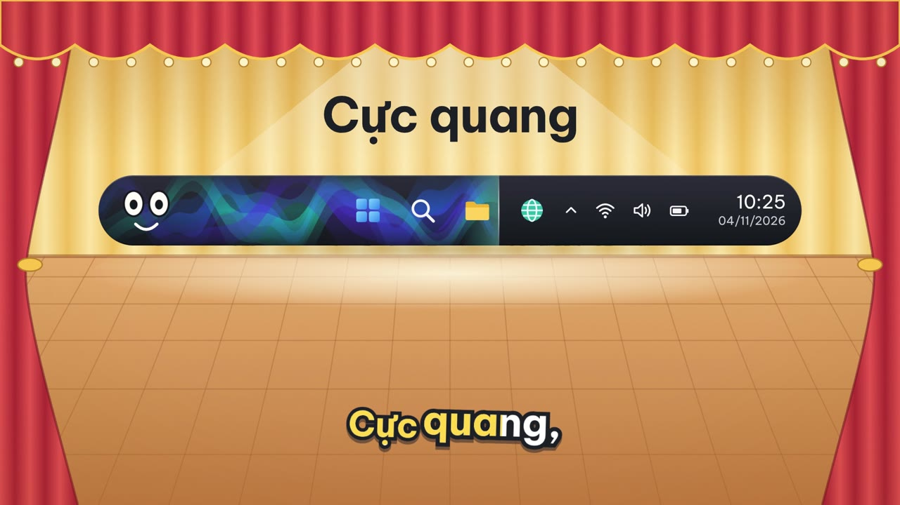
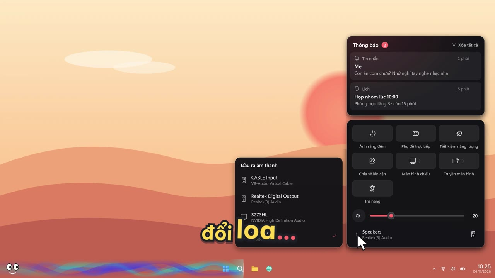
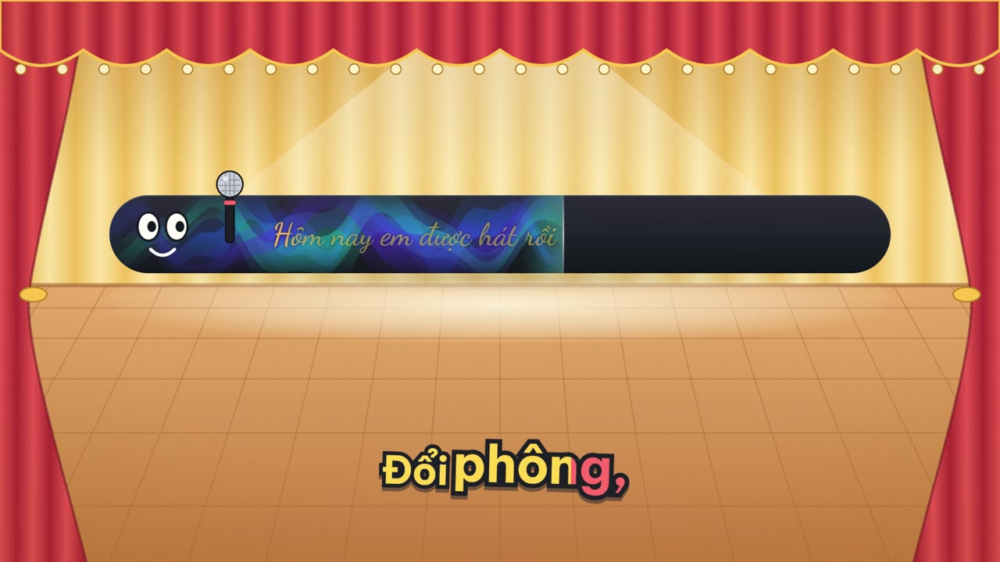

# MusicBar

Thanh taskbar nằm im ba mươi năm rồi. Cho nó hát đi.

**Tải về:** [bản cài đặt](https://github.com/lvt1693/music-bar/releases/latest/download/MusicBar-1.0.0-Setup.exe)
hoặc [bản portable](https://github.com/lvt1693/music-bar/releases/latest/download/MusicBar-1.0.0-portable.zip)
(Windows 10 2004 trở lên hoặc Windows 11, 64-bit, không cần cài .NET).

- [x] **04/11** Bản 1.0 lên GitHub: 14 bộ áo cho thanh tiến trình, karaoke đủ dấu, taskbar
  Windows 11 trong suốt, trung tâm điều khiển riêng, installer, bản portable và một video
  giới thiệu có taskbar biết ngáp.



Nhạc phát cả ngày mà taskbar chỉ biết hiện mỗi cái đồng hồ. MusicBar biến cả chiều ngang
taskbar thành một thanh tiến trình đổi màu theo ảnh bìa và nhún nhảy theo nhạc thật, đặt ảnh
bìa với nút ⏮ ⏯ ⏭ ngay cạnh khay hệ thống, và cho lời bài hát chạy karaoke trên khoảng trống
của taskbar. Taskbar vẫn bấm, vẫn kéo, vẫn ghim app như cũ. MusicBar chỉ ở dưới chân nó.

Nó bắt mọi app đang phát nhạc qua Windows Media Session: Spotify, YouTube trong trình duyệt,
Media Player, Apple Music… Không có nhạc thì nó lặn mất, taskbar về nguyên trạng.

## Nó làm gì

- **Thanh tiến trình trải hết taskbar**, nằm dưới các icon, phần đã phát phủ màu từ mép trái.
  Mười bốn kiểu (bảng bên dưới), kiểu nào cũng lấy màu từ ảnh bìa, màu app đang phát, màu
  nhấn của Windows hoặc màu bạn chọn.
- **Nhảy theo nhạc thật.** Các kiểu động nghe chính âm thanh đang ra loa (WASAPI loopback),
  xử lý ngay trong máy, không gửi đi đâu. Tắt đi thì chúng nhún theo nhịp giả lập.
- **Lời bài hát đồng bộ** từ [LRCLIB](https://lrclib.net), tô màu karaoke từng chữ, 8 hiệu ứng
  đổi dòng (cuộn, mờ, quét, phóng, nảy từng chữ, gõ chữ, băng chạy…). Lời tự tìm khoảng
  trống lớn nhất trên taskbar, hoặc trượt ra cạnh ảnh bìa. Lời đã tải lưu thành `.lrc`, lần
  sau khỏi cần mạng. Lệch thì chỉnh sớm / trễ 0,25 giây cho từng bài.
- **Kiểu chữ tự chọn:** cỡ, màu, độ đậm, viền (nhỏ là viền sắc, lớn là quầng mềm), và 10
  phông miễn phí đủ dấu tiếng Việt: Be Vietnam Pro, Lexend, Montserrat, Quicksand, Nunito,
  Comfortaa, Playfair Display, Lora, Dancing Script, Pacifico.
- **Vùng yên tĩnh quanh lời:** ngay dưới dòng lời đang hiện, thanh tiến trình dịu xuống còn
  khoảng 30 %, dài ngắn theo từng dòng, nên chữ luôn đọc rõ.
- **Taskbar Windows 11 trong suốt**, tự làm, không cần cài thêm gì (chi tiết ở dưới).
- **Trung tâm điều khiển riêng:** bấm nút loa trên khay là ra một bảng gom thông báo, cài
  đặt nhanh, âm lượng và thiết bị phát. Danh sách loa trượt ra bên trái, chọn là đổi ngay.
- **Chỉnh taskbar của Windows:** cỡ nhỏ / vừa (đọc đúng cài đặt *Kích thước taskbar* mới của
  Windows 11), Start và icon ở giữa. Chạy được cả với taskbar kiểu Windows 10 của
  [ExplorerPatcher](https://github.com/valinet/ExplorerPatcher).
- **Thẻ thông tin bài hát:** giữ chuột trên ảnh bìa là ra ảnh lớn, ca sĩ, album, năm, thể loại.

## 14 bộ áo

Chọn ở **Cài đặt → Giao diện** (bản xem trước chạy thật với bài đang phát) hoặc chuột phải →
Kiểu thanh tiến trình.



| Kiểu | Trông ra sao |
| --- | --- |
| Cực quang (mặc định) | Ba dải sáng uốn lượn theo bảng màu bài hát, biên độ theo nhạc |
| Lưới màu | Những mảng màu lớn từ ảnh bìa trôi chậm, hòa vào nhau, phồng lên theo từng dải tần |
| Sợi tơ | 14 sợi tơ mảnh xoắn quanh nhau, se lại thành một sợi ở đầu phát |
| Ánh kim | Giấy kim tuyến đổi sắc quanh màu bài hát, vệt sáng lướt qua mặt giấy |
| Ánh đèn mờ | Đốm đèn bokeh xa gần, mỗi đốm nhấp nháy theo một dải tần |
| Mực loang | Màu nước loang sau đầu phát, giọt mực vẫn nở tiếp sau khi đầu phát đi qua |
| Dải màu ảnh bìa | Màu từng cột của ảnh bìa trải thành dải, lộ dần theo bài |
| Điện ảnh | Ảnh bìa nhòe sâu, trôi chậm như một cảnh phim |
| Ống neon | Ống neon dọc mép, chập chờn, hắt sáng xuống taskbar |
| Chất lỏng | Mặt chất lỏng gợn sóng ở đầu phát, bọt khí li ti |
| Phổ âm | Cột phổ âm thanh thật, phần đã phát được tô màu |
| Dạng sóng | Sóng âm kiểu SoundCloud, vẽ dần dạng sóng thật khi phát |
| Ô LED | Ma trận ô vuông lấp lánh, cột đầu phát kiêm đồng hồ mức âm |
| Cổ điển | Phủ màu và quầng sáng ở đầu phát |

Kiểu động vẽ 30 khung / giây khi đang phát (các kiểu trôi chậm 20 khung), đứng yên khi tạm dừng.

## Cài

- **Bản cài đặt** (`MusicBar-1.0.0-Setup.exe`): cài cho riêng tài khoản của bạn vào
  `%LOCALAPPDATA%\Programs\MusicBar`, không hỏi quyền admin, có mục trong Start và gỡ được
  trong Cài đặt → Ứng dụng. Cài đè hay gỡ đi thì MusicBar được báo thoát trước, để trả taskbar
  và khay về đúng như Windows sắp xếp.
- **Bản portable** (`MusicBar-1.0.0-portable.zip`): giải nén ra đâu cũng được, chạy
  `MusicBar.exe`.

Hai bản là cùng một app, đã gói sẵn .NET 10 nên không cần cài gì thêm. Lần đầu chạy, cửa sổ
cài đặt tự mở; sau đó nhấp biểu tượng ở khay để mở lại. Muốn nó chạy cùng Windows thì bật
**Khởi động cùng Windows** trong cài đặt. Cài đặt, lời bài hát và nhật ký nằm ở `%LOCALAPPDATA%\MusicBar`
cho cả hai bản.

App chưa có chữ ký số, nên lần đầu SmartScreen sẽ cản: bấm **More info → Run anyway**.

Dòng lệnh, nếu bạn thích:

```powershell
MusicBar.exe --demo       # bài hát mẫu có sẵn lời, không cần trình phát nào
MusicBar.exe --settings   # mở cài đặt (cả khi app đang chạy)
MusicBar.exe --exit       # thoát, trả taskbar về như cũ
```

## Taskbar trong suốt

Windows không cho vẽ "vào trong" taskbar, nên thanh tiến trình là một cửa sổ riêng giữ ngay
dưới taskbar, và chỉ nhìn xuyên qua được khi taskbar trong suốt. Bật ở **Cài đặt → Taskbar →
Làm taskbar trong suốt**. Đang chạy [TranslucentTB](https://github.com/TranslucentTB/TranslucentTB)
thì MusicBar để nó lo.

- **Taskbar kiểu Windows 10** (Windows 10, ExplorerPatcher): đặt thuộc tính DWM của cửa sổ
  taskbar, và đặt lại mỗi khi Explorer tự đổi nền (mở Start, đổi theme).
- **Taskbar Windows 11 gốc:** nền là một phần tử XAML bên trong Explorer. MusicBar nạp một
  module nhỏ (`MusicBar.TaskbarTap.dll`, nhúng sẵn trong app) vào Explorer theo cách
  TranslucentTB làm, viết lại độc lập. Module dùng API chẩn đoán XAML công khai để thay brush
  nền bằng brush trong suốt, giữ brush gốc để trả lại. Nó chỉ giữ nền trong suốt khi MusicBar
  còn sống: MusicBar thoát hay bị tắt ngang là taskbar tự có lại nền.

| Chế độ lớp | Khi nào |
| --- | --- |
| Tự động (mặc định) | Taskbar trong suốt được thì nằm dưới icon, không thì phủ mờ lên trên |
| Nằm dưới icon | Taskbar đã trong suốt: trông như chính nền taskbar |
| Phủ mờ lên taskbar | Taskbar không trong suốt: phủ lên trên, tự giới hạn độ đậm để icon vẫn rõ |

## Trung tâm điều khiển



Khi MusicBar chạy, nút mạng / âm lượng (Windows 11) hoặc nút Control Center (ExplorerPatcher)
mở bảng của MusicBar, từ trên xuống:

- **Thông báo** của Windows: bấm để mở app gửi, × để bỏ từng cái, *Xóa tất cả* để dọn.
- **Cài đặt nhanh:** Wi-Fi, Bluetooth, Ánh sáng đêm, Phụ đề trực tiếp bật / tắt thật. *Màn
  hình chiếu* (như Win+P) và *Truyền màn hình* (Miracast) mở danh sách trượt ra bên trái.
- **Âm lượng** và **thiết bị phát**: danh sách loa trượt ra, chọn là đổi ngay.

Bảng gốc của Windows vẫn ở đó: Win+A và Win+N. Tắt tính năng hoặc thoát MusicBar là khay về
nguyên như Windows sắp xếp.

## Lời bài hát



Tìm theo thứ tự: file `.lrc` trong thư mục lời (`%LOCALAPPDATA%\MusicBar\Lyrics`, tên
`Ca sĩ - Tên bài.lrc`, tự thả file của mình vào cũng được), rồi tới LRCLIB theo tên bài, ca sĩ,
album và thời lượng. Tiêu đề kiểu YouTube được dọn bớt ("Official MV", "(Lyrics)", "feat.")
trước khi tìm. Bài không có lời được nhớ 3 ngày để khỏi hỏi lại. Mạng cần proxy thì điền ở
**Cài đặt → Lời bài hát → Proxy**.

## Build

Cần .NET 10 SDK, và MSVC (Visual Studio hoặc Build Tools, workload "Desktop development with
C++") cho module taskbar Windows 11.

```powershell
dotnet build src/MusicBar/MusicBar.csproj
dotnet run --project src/MusicBar -- --demo
.\installer\build.ps1 -Version 1.0.0     # ra artifacts\: Setup.exe (Inno Setup 6) và portable.zip
```

## Bên trong

```
src/MusicBar/
  App.xaml(.cs)                 khởi động, một phiên bản duy nhất, khay hệ thống
  Models/AppSettings.cs         mọi tùy chọn (%LOCALAPPDATA%\MusicBar\settings.json)
  Services/MediaService.cs      theo dõi session, nội suy vị trí phát, điều khiển
  Services/LyricsService.cs     cache .lrc + LRCLIB;  LrcParser.cs đọc LRC
  Services/AudioOutputs.cs      thiết bị phát, âm lượng, đổi loa mặc định
  Services/NotificationFeed.cs  đọc / bỏ thông báo của Windows
  Interop/TaskbarTracker.cs     vị trí taskbar, dò khoảng trống bằng UI Automation
  Interop/XamlTaskbar.cs        nạp module làm trong suốt taskbar Windows 11
  Interop/TrayMerge.cs          ẩn icon âm lượng / chuông, dồn khay, khôi phục
  Views/SeekRenderer.cs         14 kiểu thanh tiến trình
  Views/LyricsPresenter.cs      lời bài hát và các hiệu ứng
  Views/TaskbarOverlay.cs       điều phối: xếp lớp, màu, lời, menu
src/MusicBar.TaskbarTap/        module C++ chạy trong Explorer (build bằng MSVC cùng app)
installer/                      Inno Setup + build.ps1
promo/                          video giới thiệu (HyperFrames)
```

## Video giới thiệu

Video 52 giây trong [release](https://github.com/lvt1693/music-bar/releases/latest): một thanh
taskbar ngủ gật, kèn buồn, tiếng cào đĩa, rồi sân khấu bật đèn. Toàn bộ phần MusicBar trong
video là chính code của app vẽ ra (`promo/tools/capture` gọi thẳng SeekRenderer,
LyricsPresenter và bảng điều khiển), phần còn lại là HTML dựng bằng
[HyperFrames](https://hyperframes.heygen.com). Giọng đọc từ queen-tts, nhạc nền và tiếng động
từ ElevenLabs. Muốn dựng lại: vào `promo/`, `npx hyperframes preview`.

## Nói thật

- Mới chạy kỹ trên Windows 11 (bản 26300), cả taskbar gốc lẫn taskbar ExplorerPatcher.
  Windows 10 có code cho nó nhưng chưa thử trên máy Windows 10 thật.
- Module taskbar Windows 11 nằm trong Explorer tới khi Explorer khởi động lại, kể cả sau khi
  gỡ MusicBar. Nó không làm gì khi MusicBar không chạy. Phần mềm diệt virus có thể để ý
  chuyện một DLL được nạp vào Explorer.
- Chưa có chữ ký số, nên SmartScreen sẽ hỏi lần đầu.
- Chỉ taskbar chính, nằm ngang (trên hoặc dưới màn hình).
- Trên Windows 11, nút mạng / âm lượng được nhận ra qua tên hiển thị (Windows tiếng Anh và
  tiếng Việt).
- Ô Ánh sáng đêm ghi vào một giá trị CloudStore không có tài liệu (định dạng do cộng đồng
  giải mã). Gặp trường lạ là MusicBar không ghi.
- Click lên taskbar thì Windows kéo taskbar lên trên cùng. MusicBar đặt lại thứ tự ngay, và
  kiểm tra lại mỗi 250 ms.

## Cảm ơn

[TranslucentTB](https://github.com/TranslucentTB/TranslucentTB) đã chỉ đường vào nền XAML của
taskbar Windows 11. [LRCLIB](https://lrclib.net) cho lời bài hát.
[ExplorerPatcher](https://github.com/valinet/ExplorerPatcher) giữ taskbar kiểu cũ sống tới giờ.
Phông chữ từ [Google Fonts](https://fonts.google.com). Installer dựng bằng
[Inno Setup](https://jrsoftware.org/isinfo.php).

## License

[MIT](LICENSE). Các phông chữ đi kèm dùng giấy phép SIL Open Font License; bản giấy phép nằm
trong `Assets/Fonts/licenses` cạnh app.

## English, briefly

MusicBar turns the Windows taskbar into a music bar. It sits under the taskbar (which stays
fully usable) and adds:

- a full-width progress bar in 14 styles that take their colours from the cover art and dance
  to the audio actually playing;
- cover art and transport buttons next to the tray;
- synced karaoke lyrics from LRCLIB, laid out in the taskbar's free space, with 10 bundled
  fonts that cover Vietnamese;
- its own taskbar transparency for Windows 11 (an in-process XAML diagnostics module, done the
  way TranslucentTB does it, written independently);
- a control center that gathers notifications, quick settings, volume and output devices.

It follows any app that talks to Windows Media Session (Spotify, browsers, Media Player…).
Grab the installer or the portable zip from the
[latest release](https://github.com/lvt1693/music-bar/releases/latest). Both are
self-contained, so there is no .NET to install. The UI is in Vietnamese; the code and its
comments are in English.
